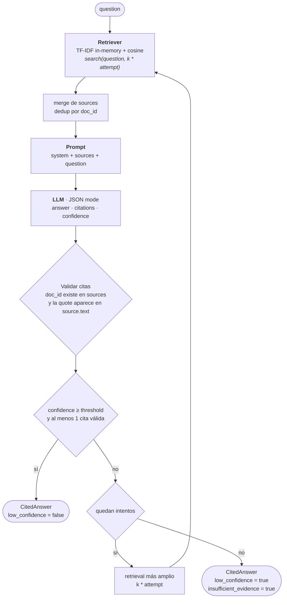
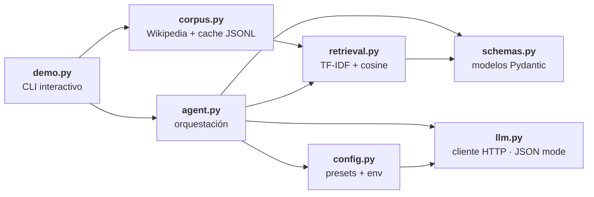

# rag-citation-agent

Agente RAG que recupera contexto, responde citando fuentes
y marca respuestas de baja confianza. Si la evidencia es insuficiente,
hace fallback a búsqueda adicional.

**Qué demuestra:** prevención de alucinaciones con citas y umbrales.

## Checklist de features clave

- [x] Recuperar contexto relevante desde el índice/vector store
- [x] Responder siempre con fuentes citadas
- [x] Detectar y marcar respuestas de baja confianza
- [x] Fallback a búsqueda cuando el contexto no alcanza

## Cómo funciona



El loop es lo que hace que una respuesta débil no pase como si estuviera
grounded: cada reintento amplía el retrieval (`k * attempt`), y si se agotan
los intentos la respuesta sale marcada explícitamente como insuficiente.
Defaults: `threshold=0.6`, `max_attempts=2`, `k=3` (todos por env, ver
[Configuración](#configuración-todo-por-env)).

Diseñado a mano a propósito: el mecanismo (retrieval, validación de citas,
umbral de confianza, fallback) es el contenido del repo, no un detalle de
implementación de un framework.

### Mapa de módulos



- `rag_agent/retrieval.py` — vector store TF-IDF in-memory con interfaz `Retriever` (swappable por embeddings reales después)
- `rag_agent/llm.py` — cliente OpenAI-compatible (chat completions con `response_format: json_object`); tolera respuestas con fences o con el JSON embebido en prosa
- `rag_agent/config.py` — presets de proveedor (`openrouter`, `openai`) y overrides por env
- `rag_agent/corpus.py` — descarga de resúmenes de Wikipedia, cache JSONL e indexado
- `rag_agent/agent.py` — orquestación: retrieve → answer → validar citas → confidence gate → fallback
- `rag_agent/schemas.py` — modelos Pydantic (`Source`, `Citation`, `CitedAnswer`)
- `demo.py` — demo interactivo sobre el corpus local

## Configuración (todo por env)

| Variable | Default | Qué hace |
|---|---|---|
| `LLM_PROVIDER` | `openrouter` | Preset: `openrouter` \| `openai` |
| `LLM_BASE_URL` | — | Override: cualquier endpoint OpenAI-compatible |
| `LLM_MODEL` | — | Override del modelo del preset (los defaults viven en `rag_agent/config.py`) |
| `LLM_API_KEY` | — | Key (fallback: `{PROVIDER}_API_KEY`, ej. `OPENAI_API_KEY`) |
| `AGENT_CONFIDENCE_THRESHOLD` | `0.6` | Confianza mínima para aceptar la respuesta |
| `AGENT_MAX_ATTEMPTS` | `2` | Intentos de retrieve+answer antes de rendirse |
| `AGENT_RETRIEVAL_K` | `3` | Sources recuperados por intento |

Las variables se leen del entorno. `demo.py` además carga un `.env` en la raíz del
repo (vía `python-dotenv`), así que alcanza con poner `LLM_API_KEY=sk-or-...` ahí
en vez de exportarla en cada shell.

## Uso

```bash
uv sync
export LLM_API_KEY=sk-or-...   # o ponela en un .env en la raíz del repo

uv run python - <<'PY'
from rag_agent.agent import RagCitationAgent
from rag_agent.retrieval import TfidfRetriever

retriever = TfidfRetriever()
retriever.add("d1", "The Eiffel Tower is located in Paris, France.")
retriever.add("d2", "The Great Wall of China stretches over 21,000 kilometers.")

agent = RagCitationAgent.from_env(retriever=retriever)
result = agent.answer("Where is the Eiffel Tower?")

print(result.answer)
for c in result.citations:
    print(f"  [{c.doc_id}] \"{c.quote}\"")
print(f"confidence: {result.confidence:.2f} | low: {result.low_confidence}")
PY
```

## Demo interactivo

En lugar del ejemplo anterior, el script `demo.py` baja 20 resúmenes de Wikipedia a `data/corpus.jsonl` (una vez, con internet) y después corre offline:

```bash
uv run python demo.py --fetch                    # baja el corpus (1 vez)
uv run python demo.py                            # loop interactivo, 'q' para salir
uv run python demo.py --ask "Where is the Eiffel Tower?"   # pregunta única
```

Si `data/corpus.jsonl` no existe, `demo.py` lo baja solo en la primera corrida
aunque no pases `--fetch`. Los 20 tópicos están listados en `rag_agent/corpus.py`
y el corpus queda cacheado como JSONL: después de la primera descarga todo corre
offline.

Salida típica:

```
a: The Eiffel Tower is located in Paris, France.
citations:
  [wiki:Eiffel_Tower] "The Eiffel Tower is a wrought-iron lattice tower in Paris, France."
confidence: 0.90 | low_confidence: False | insufficient_evidence: False
```

## Tests

```bash
uv run pytest
```

Los tests no tocan la red: el LLM se inyecta (`FakeLLM` scriptable), así que
todo el pipeline —validación de citas, umbral, fallback— se prueba determinísticamente.
